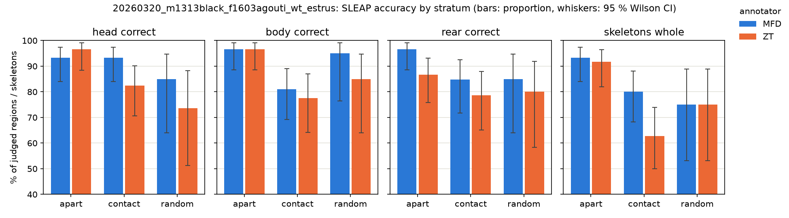
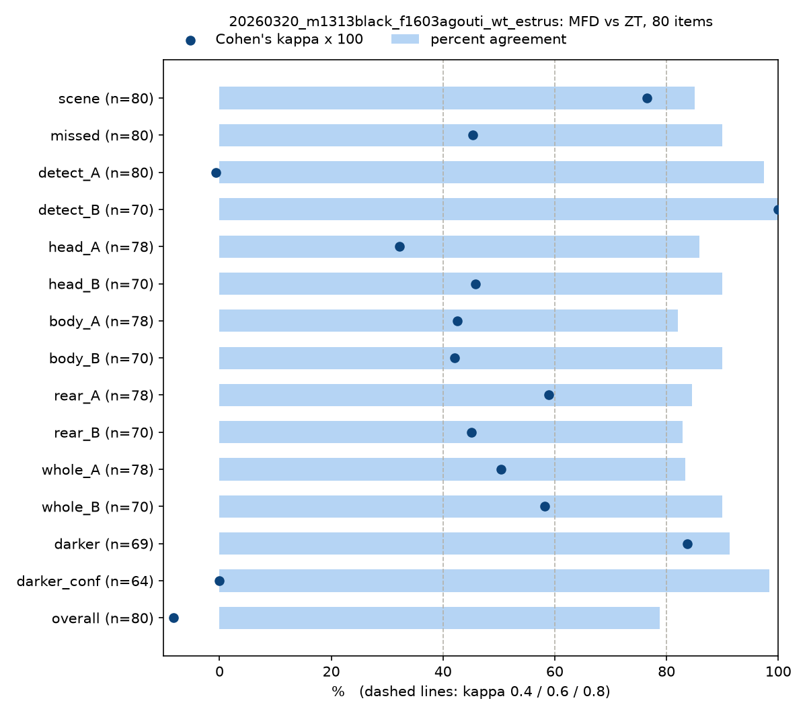
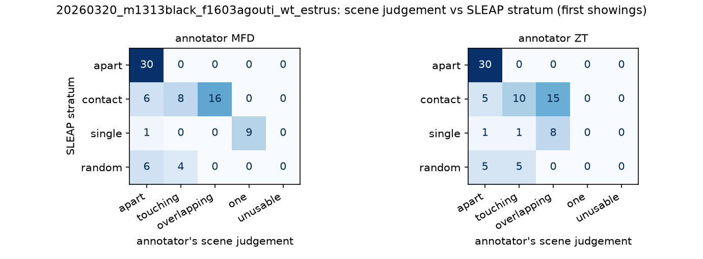

# Results – manual annotation, protocol v1.0

Status: **video m1313 complete with two annotators (MFD, ZT)**. Videos m1599 and m1600 have one record (ZT) each;
their results are not reported here until the second annotator is done, so that the second annotator stays blind.

| Video | Records | Report | Figures |
|---|---|---|---|
| [20260320_m1313black_f1603agouti_wt_estrus](20260320_m1313black_f1603agouti_wt_estrus/) | MFD, ZT | [report.md](20260320_m1313black_f1603agouti_wt_estrus/report.md) | fig 1–3 below |
| 20260322_m1599agouti_f1550black_wt_diestrus | ZT | pending (second annotator) | – |
| 20260322_m1600agouti_f1553black_wt_diestrus | ZT | pending (second annotator) | – |

## 1. Question

How reliable are the raw SLEAP poses (`predictions_raw.slp`, before identity assignment and cleaning), and does the
fur-colour rule of the identity script pick the right mouse? Is a human judgement of this reproducible between two people?

## 2. Material and methods

- **Video:** 20260320_m1313black_f1603agouti_wt_estrus, top camera, 25 fps, 44,977 frames. Male black, female agouti.
- **Sampling** ([sample_frames.py](../scripts/sample_frames.py), seed 0, first 3,000 frames skipped): 80 frames in four
  strata defined from the SLEAP output: *apart* (two skeletons, > 250 px apart, n = 30), *contact* (< 120 px, n = 30),
  *single* (one skeleton, n = 10), *random* (n = 10). Plus 8 hidden repeats → 88 items.
- **Annotation** ([PROTOCOL.md](../PROTOCOL.md)): two annotators, independently, blinded to stratum, frame number and
  scores. Each item: scene (Q1), detection per skeleton (Q2), missed mouse (Q3), head / body / rear region correct (Q4),
  skeleton whole (Q5), darker mouse (Q6), overall confidence (Q7). ±5 context frames were available.
- **Analysis** ([analyze_reviews.py](../scripts/analyze_reviews.py), [plot_reviews.py](../scripts/plot_reviews.py)):
  proportions with 95 % Wilson intervals on first showings; regions judged *not visible* are excluded from the
  denominator. Inter-rater agreement: percent agreement and Cohen's kappa. Intra-rater agreement: the 8 repeats.

## 3. Results (m1313)

### 3.1 Pose accuracy depends on contact



| Measure | Apart (MFD / ZT) | Contact (MFD / ZT) |
|---|---|---|
| head correct | 93 % [84–97] / 97 % [88–99] | 93 % [84–97] / 82 % [71–90] |
| body correct | 97 % [89–99] / 97 % [89–99] | 81 % [69–89] / 78 % [64–87] |
| rear correct | 97 % [89–99] / 87 % [76–93] | 85 % [72–92] / 79 % [65–88] |
| skeleton whole | 93 % [84–97] / 92 % [82–96] | 80 % [68–88] / 63 % [50–74] |

With the mice apart, 87–97 % of regions are correct. In contact, both annotators see lower values, most clearly for
the body region and for whole skeletons (stretched or joining points of both mice). 99 % of all skeletons lie on a
real mouse (149/150 for both annotators); ghost skeletons are practically absent.

### 3.2 The fur-colour identity rule agrees with both annotators

Where an annotator could tell the darker mouse, it was the one the identity script picks in 67/68 (MFD) and 66/66 (ZT)
items (99 % [92–100] and 100 % [94–100]). Agreement between annotators on the darker mouse: kappa 0.84.

### 3.3 Agreement between annotators



- Substantial or better: darker mouse (κ = 0.84), scene (κ = 0.76).
- Moderate: missed mouse, regions and whole skeleton (κ = 0.32–0.59, percent agreement 82–90 %).
- `detect_A`, `darker_conf` and `overall` have 79–98 % agreement but κ ≈ 0: nearly all answers fall in one category,
  so chance agreement is already close to 1 (kappa paradox). For these fields percent agreement is the measure to report.

### 3.4 Main disagreement: frames where SLEAP found one mouse



12 of 80 items have a different scene judgement; 9 of them are in the *single* stratum. MFD judged 9/10 of these
frames *one mouse visible*, ZT judged 8/10 *overlapping* and marked a missed mouse in all 10. The protocol does not
say whether a mouse that is almost fully hidden by the other counts as visible, so the difference is a rule gap, not
an annotation error. Either way, in these frames the second mouse is physically present and SLEAP has no skeleton for it.

### 3.5 Intra-rater agreement

Repeats answered identically: MFD 5/8, ZT 3/8. Per field, agreement on repeats is 75–100 % for both.

## 4. Limitations

- One video, two annotators, 80 frames: the intervals are wide (often ± 10 points).
- Strata were drawn independently, so a few sampled frames lie less than 2 s apart (m1313: 3 pairs) and are not
  fully independent observations.
- During annotation, MFD asked an assistant about the decision rules; items I51, I57 and I76 (I76 is the hidden repeat
  of I51) were discussed in this way. The intra-rater pair I51/I76 is therefore not independent.
- MFD changed 29 answers after the reveal (22 of them back and forth within item I20); the analysis uses final answers.
- Kappa is unreliable for fields with one dominant answer (section 3.3).

## 5. Open decisions

1. Agree on the rule for an almost fully hidden mouse (discuss items I27, I30, I42, I44, I51, I67, I70, I72, I81,
   then I03, I22, I52). Write it into the protocol as v1.1 for new videos; m1599 and m1600 are finished with v1.0.
2. For new videos: a minimum spacing between sampled frames (e.g. 50 frames).

## Reproduce

```powershell
cd $HOME\Desktop\Projektanalyse\Notebooks\03_quality_check
$PY = "$(uv tool dir)\sleap\Scripts\python.exe"
$N  = "20260320_m1313black_f1603agouti_wt_estrus"
$R  = "records\annotation_${N}_MFD_20261106-1333.json", "records\annotation_${N}_ZT_20261102-1218.json"
& $PY scripts\analyze_reviews.py @R --out results\$N\report.md
& $PY scripts\plot_reviews.py    @R --out results\$N
```
