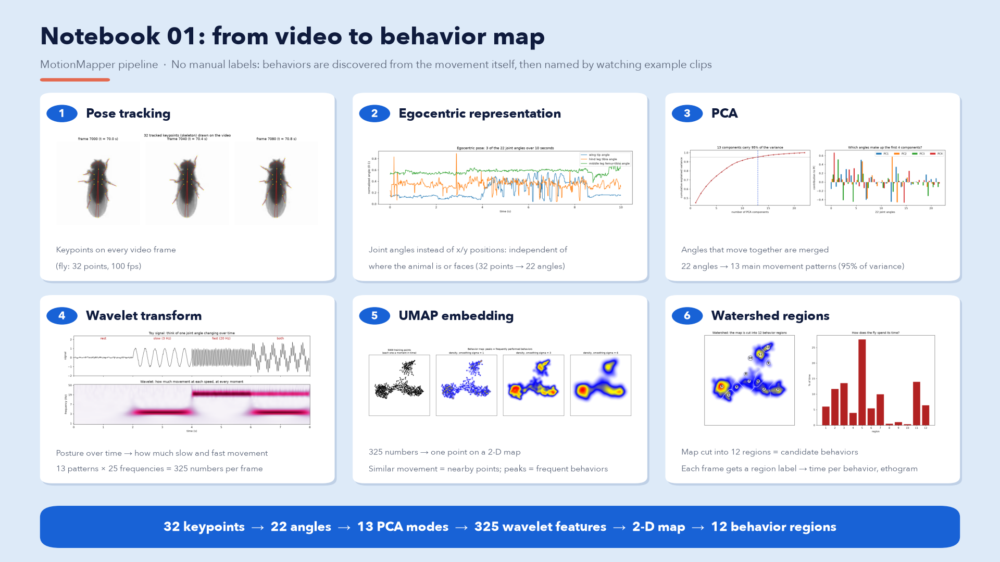

# Projektanalyse Bioinformatik: Unsupervised Behaviour Mapping

**A university data-science project on discovering animal behaviours from pose-tracking data without manual labels.**

The long-term goal is to categorise mouse behaviour from video, in particular male–female interaction, so that future studies do not depend on hand-labelled behaviour. The method follows the MotionMapper approach of the Berman lab ([unsupervised-behavior-tutorials](https://github.com/bermanlabemory/unsupervised-behavior-tutorials)). This repository currently contains the first stage: a step-by-step reimplementation and analysis of that pipeline on the public fruit-fly demo data, with explanatory figures for each step.



## Research question

Can recurring, interpretable behaviours be found directly in the movement of tracked body parts, without predefined categories, and can this be transferred to two-animal mouse recordings (top and side camera)?

## Data

| Dataset | Status |
| --- | --- |
| Fruit-fly demo recordings (`fly_leap_test`, `fly_leap_test_2`) from the tutorial repository: 32 tracked keypoints per frame, 100 fps | Used for all current results |
| Mouse interaction videos from the research group, two cameras (top + side); partly raw, partly already pose-tracked | Not yet analysed; format and labels still to be confirmed |

The fly data is not stored in this repository; it comes with the tutorial repository (see *Reproducing*). Pose estimation for the mouse videos uses [SLEAP](https://sleap.ai) with the research group's trained model; the current state, setup and plan are in [SLEAP_PIPELINE.md](SLEAP_PIPELINE.md).

## Method pipeline

```
keypoints (x, y) ──► median filter ──► joint angles ──► PCA ──► Morlet wavelets ──► UMAP ──► watershed ──► ethogram
   32 points          tracking jumps     22 angles      13 modes   13 × 25 = 325      2-D map    12 regions    behaviour
                                         (egocentric)   (95 % var.) features/frame                            over time
```

1. **Pose tracking and cleaning.** Keypoint trajectories are loaded and smoothed with a temporal median filter to remove tracking jumps.
2. **Egocentric representation.** Pairs of body-part vectors are converted into 22 joint angles, so the description does not depend on where the animal is or which way it faces. Angles are min–max normalised.
3. **PCA.** Correlated angles are compressed into the smallest number of modes that explain 95 % of the variance (13 for the fly data).
4. **Wavelet transform.** A Morlet continuous wavelet transform (25 frequencies, 1–50 Hz) turns posture into postural dynamics: how much slow and fast movement each mode shows at every moment.
5. **UMAP embedding.** The 325-dimensional per-frame features are embedded into a 2-D behaviour map (training subset, then re-embedding of all frames); a Gaussian-smoothed density shows frequently performed behaviours as peaks.
6. **Watershed segmentation.** The density map is split into 12 regions, i.e. candidate behaviours. Each frame receives a region label, giving an ethogram and time spent per behaviour.

Steps 4–6 use the pinned `motionmapperpy` package from the tutorial repository; steps 1–3 use NumPy, SciPy and scikit-learn directly. Several steps also include small synthetic "toy" examples (PCA, wavelet, UMAP, watershed) that make the idea of each step visible before it is applied to real data.

## Results so far

- The complete fly pipeline runs locally from raw keypoints to an ethogram; the figures in `calisma/cikti/` are its outputs.
- With the current settings the fly data reduces to 22 angles → 13 PCA modes → 325 wavelet features → a 2-D map with 12 watershed regions.
- **Region names are not validated.** First interpretations were made from still frames only; naming regions properly by watching example clips is still to do.
- No mouse data has been processed yet, and no quantitative evaluation (e.g. against manual labels) exists.

| Step | Figure |
| --- | --- |
| Skeleton on video frames | [1_skeleton.png](calisma/cikti/en/1_skeleton.png) |
| Joint angles over time | [2_angles.png](calisma/cikti/en/2_angles.png) |
| PCA variance and loadings | [3_pca.png](calisma/cikti/en/3_pca.png) |
| Wavelet transform | [4_wavelet.png](calisma/cikti/en/4_wavelet.png) |
| UMAP map and density | [5_umap.png](calisma/cikti/en/5_umap.png) |
| Watershed regions and time per region | [6_regions.png](calisma/cikti/en/6_regions.png) |

Further working figures (ethogram, example bouts per region, toy examples) are in `calisma/cikti/`; their titles and labels are in Turkish.

## Reproducing

Requires Python 3.11 (the tutorial code needs an older scientific stack). Run from the repository root.

```sh
# 1. Tutorial repository with the demo data and motionmapperpy (ignored by git)
git clone https://github.com/bermanlabemory/unsupervised-behavior-tutorials
cd unsupervised-behavior-tutorials/motionmapperpy
git checkout ffd071d362ef8c3a508e8eabd612639aa433184d
cd ../..

# 2. Environment
python3.11 -m venv .venv311
source .venv311/bin/activate          # Windows: .venv311\Scripts\activate
pip install numpy scipy scikit-learn scikit-image matplotlib pandas tables h5py \
    hdf5storage opencv-python tqdm easydict umap-learn ipykernel

# 3. Pipeline (in this order; each step reads the previous step's .npz/.npy output)
python calisma/nb01_adim1_2.py        # cleaning, joint angles, PCA
python calisma/nb01_adim3_wavelet.py  # wavelet features
python calisma/nb01_adim4_umap.py     # UMAP map (builds calisma/Fly_mmpy/)
python calisma/nb01_adim5_watershed.py  # watershed regions, ethogram

# 4. English summary figures and overview page
python calisma/nb01_ozet_figurler_en.py
python calisma/nb01_ozet_sayfa_v2.py
```

Notes: confirm that the demo data is present in `unsupervised-behavior-tutorials/motionmapperpy/data/fly/`. Installing `tables` may need a prebuilt wheel. The wavelet, UMAP and watershed scripts use multiprocessing and are therefore wrapped in an `if __name__ == "__main__":` guard. Intermediate `.npy`/`.npz` files and the `Fly_mmpy/` project folder are regenerated and not committed. There is no automated test suite.

## Repository structure

```
calisma/
  nb01_adim1_2.py            cleaning, joint angles, PCA
  nb01_adim2_temsil_demo.py  why joint angles: raw x/y vs. angles under rotation
  nb01_pca_oyuncak.py        toy PCA example
  nb01_adim3_wavelet.py      Morlet wavelet features
  nb01_adim4_umap.py         UMAP behaviour map and density
  nb01_adim4_hareket_rengi.py  map coloured by movement amplitude
  nb01_adim5_watershed.py    watershed regions, ethogram, example bouts
  nb01_ozet_*.py             English summary figures and overview page
  sleap_*.py                 mouse videos: identity, cleaning, check plots, skeleton video (see SLEAP_PIPELINE.md)
  cikti/                     generated figures (cikti/en/: English versions)
```

Script and folder names are Turkish (*calisma* = work, *cikti* = output, *adim* = step, *ozet* = summary).

## Status and next steps

Work in progress. Next steps:

- Validate and name the fly behaviour regions by watching example clips per region.
- Study behavioural transitions and the rat social-behaviour tutorial, which is closest to the mouse setting.
- Load SLEAP output for the mouse recordings and adapt the pipeline to two interacting animals (identity tracking, inter-animal features, two cameras).
- Clarify data details with the research group: frame rate, camera synchronisation, identity tracking, experimental groups and any existing manual labels.

## Acknowledgements

The pipeline and demo data are based on the Berman lab's MotionMapper and [unsupervised-behavior-tutorials](https://github.com/bermanlabemory/unsupervised-behavior-tutorials).
